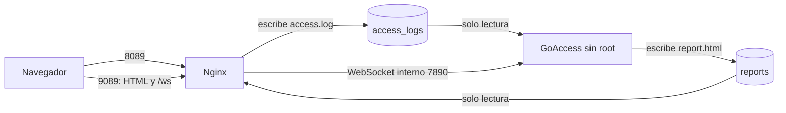
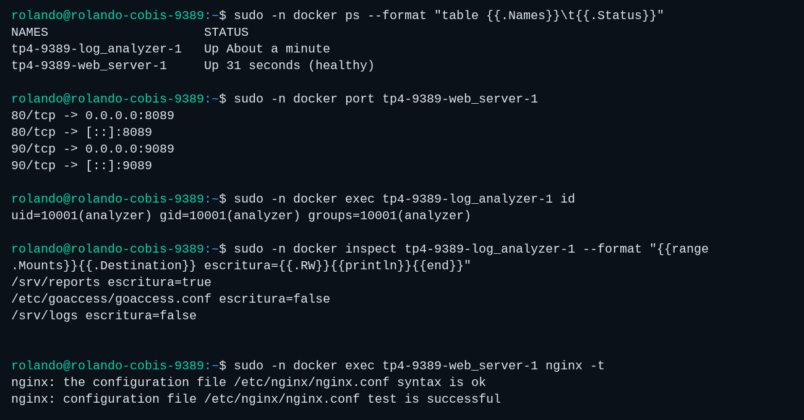
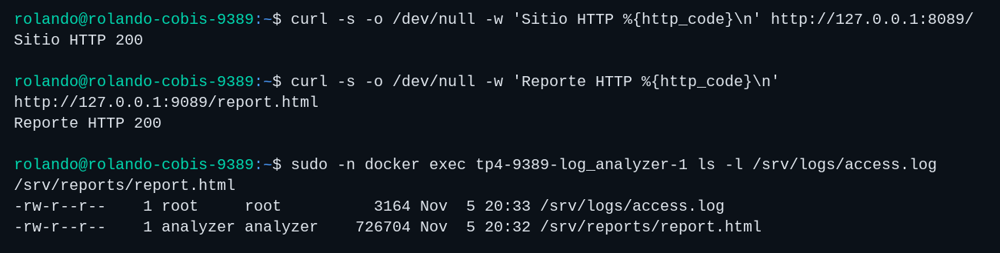
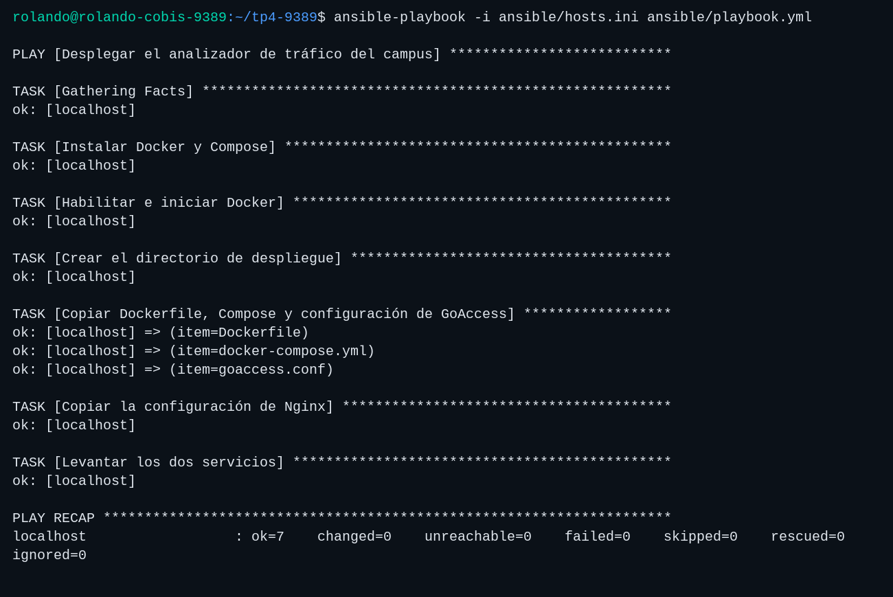
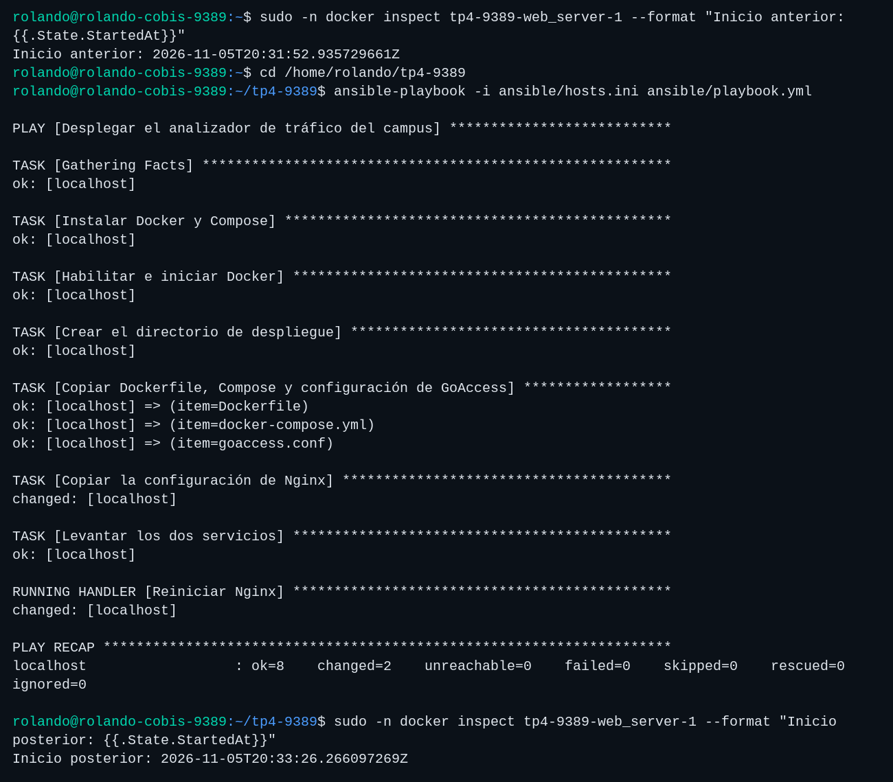
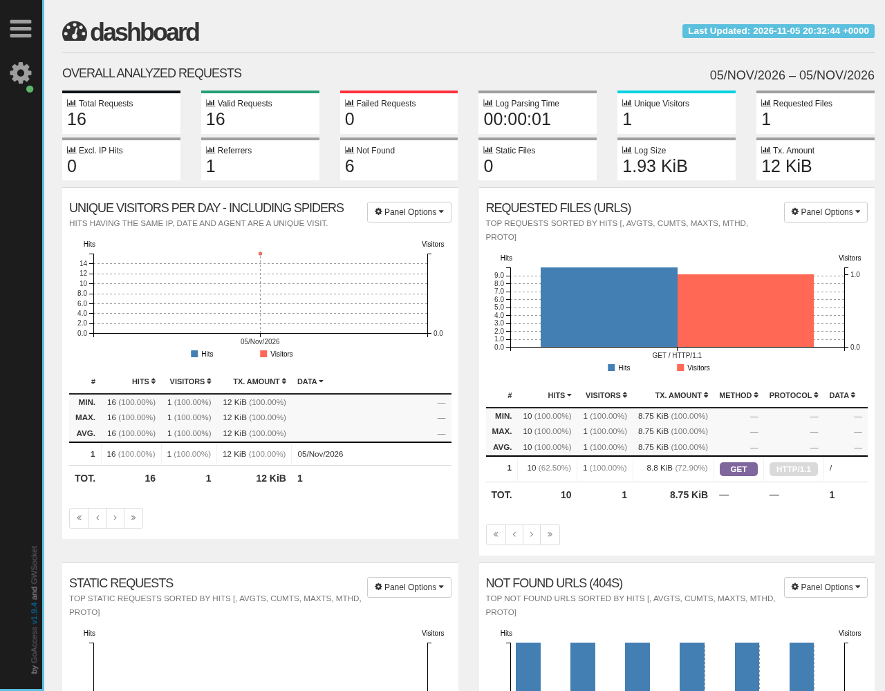
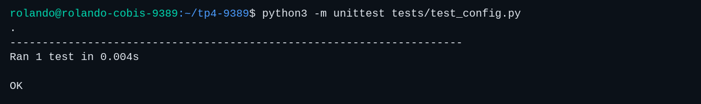

# Trabajo Práctico 4: Automatización y Scripting

Universidad Nacional del Comahue, Centro Regional Zona Atlántica.
Tecnicatura Superior en Administración de Sistemas y Software Libre.

Alumno: Rolando Cobis. Legajo: CURZA-9389.
Docente: Ramiro García Poggi. Entrega: 5 de noviembre de 2026.

## Resolución

### Entorno y puertos

Ejecuté el laboratorio en Ubuntu Server 24.04.5, en la VM de los TPs anteriores.
Instalé Docker y Compose mediante Ansible. Dejé los contenedores anteriores de
Podman fuera de este despliegue.

| Acceso | Puerto del host | Puerto del contenedor |
| --- | --- | --- |
| Sitio Nginx | 8089 | 80 |
| Reporte y WebSocket | 9089 | 90 |
| GoAccess, red interna de Compose | Sin publicar | 7890 |

Calculé los puertos como 8000 + 89 y 9000 + 89, usando el legajo 9389.

### Organización

```text
tp4-9389/
├── README.md
├── TP4-AyS-Cobis.typ
├── TP4-AyS-Cobis.pdf
├── .github/workflows/ci-pipeline.yml
├── docker/
│   ├── Dockerfile
│   ├── docker-compose.yml
│   ├── nginx.conf
│   └── goaccess.conf
├── ansible/
│   ├── hosts.ini
│   ├── playbook.yml
│   └── requirements.yml
├── tests/
│   ├── __init__.py
│   └── test_config.py
└── capturas/                       Registros .txt e imágenes .png
```

### Recorrido de los datos



Usé el formato `combined` incorporado en Nginx. Monté los logs como solo lectura
para GoAccess y el reporte como solo lectura para Nginx. El usuario del analizador
tiene UID 10001. El chequeo HTTP de Nginx genera la primera entrada de acceso antes
de iniciar el analizador; esas consultas también aparecen en las estadísticas.

### Preparación de Ansible

Ejecuté Ansible dentro de la VM, conectando por SSH a `127.0.0.1:4089` como
`rolando`. Usé ese puerto porque ya estaba configurado en los TPs anteriores.
Para otra máquina hay que ajustar el usuario, puerto y clave en `ansible/hosts.ini`.

Desde la raíz del repositorio, dentro de la VM Ubuntu:

```bash
sudo apt-get update
sudo apt-get install -y ansible python3-yaml
ansible-galaxy collection install -r ansible/requirements.yml
```

Preparé una clave exclusiva para la conexión local. En una VM nueva, donde esos
archivos todavía no existen:

```bash
ssh-keygen -t ed25519 -N '' -f ~/.ssh/id_ed25519_tp4
cat ~/.ssh/id_ed25519_tp4.pub >> ~/.ssh/authorized_keys
chmod 600 ~/.ssh/authorized_keys
awk '{print "[127.0.0.1]:4089 " $1 " " $2}' \
  /etc/ssh/ssh_host_ed25519_key.pub > ~/.ssh/known_hosts_tp4
```

Tomé la clave pública del servidor desde su propio archivo para verificar la
identidad del SSH local. Las claves privadas quedaron fuera del repositorio.

### Despliegue

```bash
ansible -i ansible/hosts.ini lab_systems -m ping --ask-become-pass
ansible-playbook -i ansible/hosts.ini ansible/playbook.yml --syntax-check
ansible-playbook -i ansible/hosts.ini ansible/playbook.yml --ask-become-pass
```

El playbook instaló `docker.io` y `docker-compose-v2`, habilitó Docker y copió
los archivos a `/opt/tp4-9389`. Usé `community.docker.docker_compose_v2` para
levantar los servicios. En el laboratorio usé una regla temporal de sudo sin
contraseña; el comando anterior solicita la contraseña y permite repetirlo
sin esa regla.

Para iniciar Compose directamente, con Docker ya instalado:

```bash
sudo docker compose -f docker/docker-compose.yml up -d --build --wait
```

Para detener este laboratorio conservando sus volúmenes:

```bash
sudo docker compose -f docker/docker-compose.yml down
```

### Acceso desde la laptop

Abrí un túnel hacia la VM y lo mantuve activo mientras usé el navegador:

```bash
ssh -o IdentitiesOnly=yes -i ~/.ssh/id_ed25519_tp1 -p 4089 \
  -N -L 8089:127.0.0.1:8089 -L 9089:127.0.0.1:9089 \
  rolando@192.168.122.92
```

- Sitio: <http://localhost:8089/>.
- Reporte: <http://localhost:9089/report.html>.

Configuré el WebSocket con `localhost` para ese túnel. Para acceder directamente
por la IP de la VM, hay que ejecutar el playbook con
`-e report_host=192.168.122.92`. En Compose directo, la variable equivalente es
`REPORT_HOST`.

### Pruebas y capturas

Generé las imágenes de terminal a partir de los registros reales guardados en
los `.txt` del mismo nombre. Añadí el prompt con el usuario, equipo y directorio
de cada ejecución. La imagen del reporte es una captura del navegador.

Contenedores, puertos, usuario y permisos de los montajes:



HTTP del sitio y del reporte:



Segunda ejecución sin modificaciones: `changed=0`, `failed=0`.



Agregué un comentario de prueba a `nginx.conf`, ejecuté el playbook y comprobé
que el handler cambió la hora de inicio de Nginx. Después restauré el archivo.



Generé seis peticiones a rutas inexistentes. El reporte mostró los seis 404 y
recibió nuevos mensajes por WebSocket sin recargar la página.



### Integración continua

Configuré `.github/workflows/ci-pipeline.yml` para `push` y `pull_request` sobre
`main`. El job usa `ubuntu-latest`, prepara Python 3.12, instala PyYAML y ejecuta:

```bash
python -m unittest tests/test_config.py
```

La prueba carga el YAML y comprueba los dos servicios. También probé un YAML
mal formado: falló con `ParserError`; al restaurarlo, pasó nuevamente.
Esta prueba no reemplaza la comprobación del despliegue.


